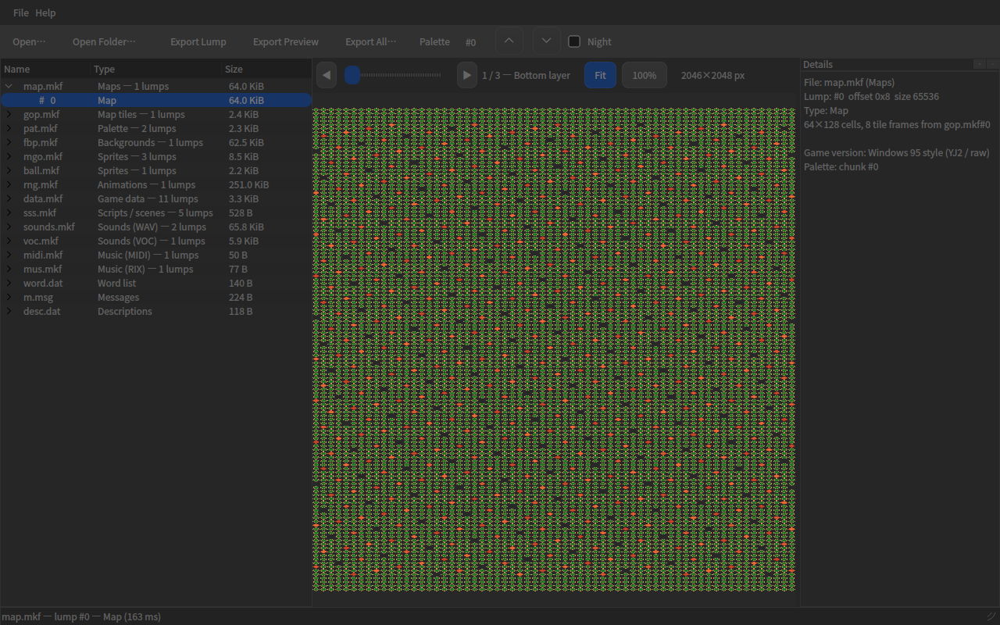

# PALook

**《仙剑奇侠传》游戏资源浏览器** —— 基于 Qt 6 的桌面工具，可以直接打开 PAL 的
游戏数据文件（MKF 压缩包及各类 .dat/.msg 资源），逐个浏览包内条目，并预览与导出
图像、地图、调色板、音效、动画和文本。



> 格式解析层是对 [SDLpal](https://github.com/sdlpal/sdlpal) 格式代码的纯 C++
> 移植（不含任何 SDL 依赖），遵循 GPLv3。

## 功能

- **打开方式**：文件夹（自动识别全部已知资源文件）或任意多个单独文件
- **文件树**：文件 → 条目两级结构，显示类型提示与体积
- **图像预览**：精灵（RLE 索引色）、整屏背景、地图；多帧条目带帧滑块，
  支持 Fit / 100% 缩放、鼠标滚轮缩放、拖拽平移、透明棋盘格背景
- **地图渲染**：64×128 格、底/顶/混合三层，按游戏算法用 `gop.mkf` 图块合成
- **调色板**：`pat.mkf` 分块选择 + 昼/夜切换，改动即时反映到当前预览
- **声音预览**：WAV / Creative VOC 波形包络图，可调用外部播放器
  （`ffplay` / `pw-play` / `paplay` / `aplay`）试听，或导出为 WAV
- **表格浏览**：道具、敌人、法术、商店、事件脚本等记录表，带过滤框
- **文本**：词库、剧情消息、描述文件；自动识别 **GB18030 / Big5** 编码并显示置信度
- **十六进制**：未知条目的原始字节查看器
- **版本检测**：自动判断 Windows 95 版（YJ2 / raw）与 DOS 版资源布局
- **导出**：单条原始字节、预览图 PNG、音频 WAV、表格文本，或一键全部导出
  （含 `index.txt` 清单）

## 支持的格式

| 资源 | 文件 | 说明 |
|------|------|------|
| MKF 压缩包 | `*.mkf` | 偏移表索引，空条目视为填充 |
| 解压 | — | YJ1、YJ2，并按上下文回退到 raw |
| 精灵 | `gop/mgo/ball/fbp*.mkf` | 8 位索引色 + RLE（透明游程） |
| 地图 | `map.mkf` | 64×128 格 × 底/顶双 dword，图块取自 `gop.mkf` |
| 调色板 | `pat.mkf` | 每块 768 字节（昼），第二块为夜 |
| 动画 | `rng.mkf` | 嵌套 MKF + 差分帧指令（0x0b/0x00） |
| 音频 | `sounds.mkf`（WAV）、`voc.mkf`（VOC） | 归一化为 PCM，可试听/导出 |
| 音乐 | `midi.mkf`（MIDI）、`mus.mkf`（RIX） | 识别并提示导出原始数据 |
| 表格 | `data.mkf`、`sss.mkf` | 商店/敌人/队伍/玩家/法术/战场/事件/场景/脚本 |
| 文本 | `word.dat`、`m.msg`、`desc.dat` | 编码自动检测 |

## 构建

依赖：**Qt 6**（Widgets）、**CMake ≥ 3.16**、支持 C++17 的编译器。

```bash
# Debian / Ubuntu
sudo apt install qt6-base-dev cmake g++

cmake -S . -B build -DCMAKE_BUILD_TYPE=Release
cmake --build build -j
./build/palook /path/to/pal-data        # 打开游戏数据文件夹
./build/palook map.mkf m.msg word.dat   # 或打开若干单独文件
```

## 命令行模式

```bash
palook [选项] [文件|目录 ...]
  --selftest <路径>     解码全部条目并输出报告（0 = 全部通过）
  --uitest <路径>       每种视图各驱动一个条目（界面冒烟测试）
  --screenshot <png>    渲染第一个图像条目并写出截图（无显示环境自动用 offscreen）
  -h, --help            帮助
```

## 测试

仓库自带合成测试数据（不包含任何真实游戏资源）：

```bash
python3 tools/gen_testdata.py testdata   # 重新生成测试数据（纯标准库）
./build/palook --selftest testdata       # 16 文件 / 34 条目，期望 0 错误
./build/palook --uitest testdata         # 6/6 视图类型全部走通
./build/palook --screenshot shot.png testdata
```

生成器同时模拟 `detectCodepage` 打分逻辑，断言三个文本文件都能被判为 GBK，
保证夹具始终覆盖正确的解码分支。

## 目录结构

```
palook/
├── CMakeLists.txt
├── src/
│   ├── core/          # 格式层（无 Qt GUI 依赖，可独立自测）
│   │   ├── mkf        # MKF 偏移表
│   │   ├── decompress # YJ1 / YJ2
│   │   ├── rle        # 精灵与地图图块 RLE
│   │   ├── palette    # 昼/夜调色板
│   │   ├── palmap     # 地图合成渲染
│   │   ├── textdec    # GB18030 / Big5 检测与解码
│   │   ├── sound      # WAV / VOC → PCM、波形包络
│   │   ├── rng        # 差分动画帧
│   │   └── gamepack   # 资源识别、版本检测、按类型解码
│   ├── ui/            # 主窗口与各预览控件
│   └── main.cpp
├── tools/
│   └── gen_testdata.py  # 合成测试数据生成器
├── testdata/           # 生成的测试资源
└── shot.png
```

## 实现要点

- **格式层与界面分离**：`src/core` 只依赖 QtCore/QtGui 的基础类型，
  `--selftest` 不创建任何窗口即可解码全部条目。
- **解压策略**：先看 `YJ_1` 签名，再按条目上下文验证 raw，最后才尝试 YJ2
  启发式（首 dword 长度合理性校验），避免误把数据当压缩流。
- **编码检测**：对 Big5 / GB18030 分别解码并统计落在 CJK、ASCII、全角标点
  区间之外的字符，严格更少者胜出，平局保持 Big5（与 SDLpal 一致）。
- **健壮性**：RNG 帧上限 400、精灵帧上限 4096、RLE 平坦坐标模型 + 边界
  硬化，全部解压路径对越界输入返回错误而不是崩溃。

## 致谢与许可

- 格式逻辑移植自 [SDLpal](https://github.com/sdlpal/sdlpal)，在此致谢。
- 本项目遵循 **GPL-3.0**（见 `LICENSE`）。
